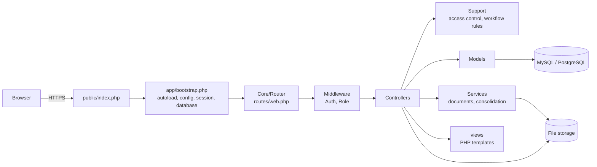

# RIDE Hub: Architecture

This document describes how RIDE Hub is built: its components, how a request is handled, how data is stored, and
how it is deployed. For what the system does, see [OVERVIEW.md](OVERVIEW.md).

## Technology

| Layer | Technology |
|---|---|
| Language | PHP 8.2 or later, no framework and no Composer dependencies |
| Web server | Apache with `mod_rewrite` (XAMPP locally) |
| Database | MySQL / MariaDB, accessed through PDO; PostgreSQL is also supported |
| Front end | Server-rendered PHP templates, plain JavaScript and CSS |
| Browser libraries (CDN) | Font Awesome, Chart.js, MapLibre GL JS, html2pdf.js, Google Fonts |
| Office documents | Official .docx and .xlsx templates filled by the application |

## Components



## Source layout

```
app/
  bootstrap.php     Constants, class autoloader (App\ to app/), configuration, session, database start
  helpers.php       Global helper functions: views, CSRF, flash messages, form-type checks, downloads
  config/           config.php (settings from environment variables), demo_accounts.php
  Core/             Framework pieces: Router, Auth, Database, Sql (dialect helpers), MysqlToPgsql, PdoSessionHandler
  Middleware/       AuthMiddleware (login required), RoleMiddleware (role required)
  Controllers/      One controller per feature area; Concerns/ holds shared controller traits
  Models/           Static data-access classes, one per table or table group, using prepared statements
  Services/         Document generation (Docx/Xlsx templates), report consolidation, co-author invitations
  Support/          Domain rules: AccessControl, ProjectAccess, ProposalRegistry, form definitions, deadlines
  views/            PHP templates by feature; partials start with an underscore
database/
  schema.sql        Baseline schema
  seeds.sql         Reference data (roles, permissions, colleges)
  migrations/       phaseN.sql files applied in order
public/
  index.php         Front controller (web root)
  .htaccess         Sends every non-file request to index.php
.htaccess           Sends every request into public/ when the document root is the project folder
  assets/           CSS, JavaScript, images
routes/web.php      All routes, with their middleware
scripts/            Command-line tools (install, demo data, cleanup, documentation)
storage/            Uploaded files (not in version control)
docs/               Documentation and the database diagram (docs/erd/)
```

Naming conventions: classes in StudlyCase matching their file names and namespaces (`App\Support\AccessControl`
in `app/Support/AccessControl.php`); methods and variables in camelCase; constants in UPPER_SNAKE_CASE; global
helper functions and database tables and columns in snake_case; view files in kebab-case.

## Request lifecycle

1. Apache passes the request to `public/index.php`: directly when the document root is `public/`, or through
   the root `.htaccess` when it is the project folder. Static assets are served directly.
2. `app/bootstrap.php` registers the autoloader, loads `app/config/config.php`, opens the database connection,
   applies pending migrations, and starts the session.
3. `routes/web.php` registers every route on the `Router` with its middleware: none (public pages), `$auth`
   (signed-in users) or `$admin` (Administrator role).
4. The router takes the path relative to `APP_URL` (`request_path()`, the same base that `base_url()` uses for
   links), matches the method and path (path parameters such as `{id}` are passed to the handler), runs the
   middleware, then calls the controller method. Unknown paths render the 404 page.
5. The controller checks permissions, validates input, calls models and services, and renders a view or
   redirects. State-changing requests are POST only and must carry a valid CSRF token.

Before controllers see it, POST text input is normalized: short text fields are title-cased, while passwords,
e-mail addresses, links and prose fields (abstracts, comments, objectives, and similar) are left as typed.

## Authentication and sessions

- Accounts sign in with e-mail and password. Passwords are stored with PHP `password_hash` (bcrypt).
- On sign-in the session ID is regenerated. The session cookie is `HttpOnly`, `SameSite=Lax`, and `Secure` over
  HTTPS. Its lifetime is set by `SESSION_LIFETIME` (default 7200 seconds).
- Sessions are stored in the `php_sessions` table (`PdoSessionHandler`), so several application servers can
  share them.
- Self-registered accounts are inactive and have no roles until an administrator approves them.

## Authorization

- **Roles** are held in `user_roles`. `RoleMiddleware` guards whole routes (the admin pages).
- **Record scope** is decided in `App\Support\AccessControl`: faculty see their own and co-authored records;
  college coordinators and deans see their college; RIDE coordinators see the colleges of their clusters
  (`user_clusters`, `colleges.research_cluster_id` / `extension_cluster_id`); directors see their office; OVPRIDE
  and the Administrator see all. Lists are filtered with `visibleProposals()` and single records are checked with
  `canViewProposal()`.
- **Project actions** (milestones, documents, reports) are decided in `App\Support\ProjectAccess`.
- **Approval** requires holding the record's current step within scope, and the approver may not be its author.

## Records and the approval workflow

All forms share one table, `proposals`. Common fields (author, college, type, title, status, current step,
project code, dates) are columns; the form's own content is a JSON document in `proposals.summary`. Its
`form_type` key is copied to the `proposals.form_type` column on every save so lists can filter by form in SQL.
`App\Support\ProposalRegistry` sorts records into proposals, requests and reports, and `app/helpers.php` holds the
`proposal_is_*` checks for each form.

The workflow is implemented in `App\Models\Proposal::advanceWorkflow()` with the chain defined in
`AccessControl::reviewChain()`:

- The action runs in one database transaction. The record row is locked first (`SELECT ... FOR UPDATE`) and the
  step the reviewer saw is checked, so two reviewers acting at once cannot both apply.
- On approval the record moves to the next step and its holders are notified; at the last step it becomes
  ongoing (proposals, with a `RIDE-` project code and default milestones), approved (requests, with a `REQ-`
  code) or approved (reports).
- Project and request codes are numbered per year from the `code_sequences` table, locked while a code is issued.
- Reviewer sections (incentive claim evaluations, the Terminal Report Assessment) are saved in
  `summary.reviews.<step>` inside the same transaction.
- Every action is written to `approval_actions` and `proposal_comments`; general changes go to `audit_logs`.

## Database

The schema has 46 tables. The diagram is in [`docs/erd/`](erd/) (`ride-erd.drawio`, with PNG and PDF exports),
one page per area: organization and access, proposals and monitoring, extension, and scholarly records,
messaging and system tables.

**Migrations.** `database/schema.sql` is the baseline. `Database::migratePending()` applies each
`database/migrations/phaseN.sql` that is not yet recorded in `schema_migrations`, in order, when a request starts.
Files ending in `_mysql` or `_pgsql` apply to that database only. To change the schema, add the next `phaseN.sql`
and register it in `Database::migratePending()`.

**Two database dialects.** MySQL / MariaDB is the primary database; PostgreSQL is also supported. Migrations are
written in MySQL syntax; on PostgreSQL, `Core\MysqlToPgsql` translates
them (types, `AUTO_INCREMENT`, `INSERT IGNORE`, `UPDATE ... JOIN`). Application queries are written to run on
both, with `Core\Sql` providing the parts that differ (date arithmetic, `GROUP_CONCAT`, upserts). On PostgreSQL,
`updated_at` is maintained by triggers and the former ENUM columns are guarded by CHECK constraints.

## File storage

Uploaded files are written under `STORAGE_PATH` and referenced from the database by a generated file name:

| Folder | Contents |
|---|---|
| `projects/<id>/` | Project document repository |
| `activities/` | Documents of conducted activities and accomplishments |
| `scholarly/` | Attachments of papers and presentations |
| `form-templates/` | Blank office forms for download |
| `avatars/`, `signatures/` | Profile photos and signature images |
| `cache/` | Cached external content (journal issue feed) |

Uploads are limited by type and size (10 MB for documents). Downloads go through `send_stored_file()`, which sets
the content type from the file extension, allows inline display only for PDF and images, and sends
`X-Content-Type-Options: nosniff`.

`STORAGE_PATH` is the `storage/` folder of the installation. It must be writable by the web server, kept out of
the web root (it is), and included in backups.

## Documents and reports

- `Services\DocxTemplate`, `Services\XlsxTemplate` and `Services\ZipPackage` fill the official office templates.
  `ResearchFormDocument`, `ExtensionFormDocument`, `QuarterlyReportFile` and `IncentiveContributionSheet` map
  record data into them, including sign-off blocks taken from the approval history.
- The consolidation services (`CompletedResearchesConsolidation`, `OngoingResearchesConsolidation`,
  `ResearchFormConsolidation`, `ResearchOutputPublishedConsolidation`, `ResearchOutputPresentedConsolidation`)
  copy approved faculty reports into the college's consolidated report draft.

## Configuration

Settings come from environment variables, read in `app/config/config.php`. Without them the application uses
the local XAMPP defaults.

| Variable | Purpose | Default |
|---|---|---|
| `DATABASE_URL` | Full connection URL (`mysql://` or `postgres://`) | none |
| `PGHOST`, `PGPORT`, `PGDATABASE`, `PGUSER`, `PGPASSWORD` | PostgreSQL connection parts | none |
| `DB_HOST`, `DB_PORT`, `DB_NAME`, `DB_USER`, `DB_PASS` | MySQL connection parts | `127.0.0.1`, `3306`, `ride_ims`, `root`, empty |
| `DB_SSL`, `DB_SSL_CA`, `DB_SSL_VERIFY` | TLS for the database connection | off (on for PostgreSQL) |
| `APP_URL` | Base URL of the application, without a trailing slash | `https://ride.wpu.edu.ph`; `http://localhost/RIDE` when opened on localhost |
| `APP_NAME`, `APP_TIMEZONE` | Display name, time zone | RIDE Hub name, `Asia/Manila` |
| `SESSION_LIFETIME` | Session lifetime in seconds | `7200` |

Secrets belong in the environment (or a local `.env`, which is not committed), never in `config.php`.

## Deployment

**Local (XAMPP).** Place the project in `htdocs\RIDE`, enable `mod_rewrite`, and run
`php scripts/install.php`, which creates the database, tables and the administrator account. The application
runs at `http://localhost/RIDE`; the root `.htaccess` sends requests into `public/`.

**Server.** In production the application runs at the root of its own domain, `https://ride.wpu.edu.ph/`, with
no `/RIDE` or `/public` in the address:

- Apache with `mod_rewrite` and PHP 8.2 or later, with the `pdo_mysql`, `mbstring`, `zip`, `dom` and `fileinfo`
  extensions.
- The virtual host's `DocumentRoot` set to the project's `public/` folder (recommended), so nothing else in the
  project can be requested. Where the document root cannot be changed, place the project in the document root;
  the root `.htaccess` then sends every request into `public/`.
- `AllowOverride All` (or at least `FileInfo`) for the folder, so the `.htaccess` rules apply.
- HTTPS enabled, and the database variables set in the server environment. `APP_URL` defaults to
  `https://ride.wpu.edu.ph`; set it only if the address changes. Links are always built from it, never from the
  request's Host header.

Example virtual host:

```apache
<VirtualHost *:443>
    ServerName ride.wpu.edu.ph
    DocumentRoot /var/www/ride/public
    <Directory /var/www/ride/public>
        AllowOverride All
        Require all granted
    </Directory>
    # SetEnv APP_URL https://ride.wpu.edu.ph   (optional; this is the default)
    # SSL settings, and SetEnv DB_HOST / DB_NAME / DB_USER / DB_PASS, go here.
</VirtualHost>
```

Migrations apply on the first request after an update. Back up the database and the `storage/` folder
together.

**Health check.** `GET /api/health` returns `{"status":"ok","database":"connected"}`, or HTTP 503 with
`"status":"error"` when the database cannot be reached. It is public and reveals no connection details. When
the database is down, other pages show a generic "temporarily unavailable" page and the details go to the
server error log.

## Security controls

| Concern | Control |
|---|---|
| Passwords | bcrypt hashes (`password_hash`); minimum 8 characters |
| Sessions | Database-stored; ID regenerated at sign-in; `HttpOnly`, `SameSite=Lax`, `Secure` cookie |
| Cross-site request forgery | Token on every POST route (`verify_csrf()`, compared with `hash_equals`) |
| SQL injection | Prepared statements; table and column names only from fixed lists |
| Cross-site scripting | Output escaped with `htmlspecialchars`; uploads served with safe content types and `nosniff` |
| Access control | Route middleware, record scope checks, no self-approval |
| Concurrency | Row-locked, transactional approvals; sequence table for codes |
| Accountability | Approval history, comments and audit log with user, time and IP address |
| Database transport | TLS for hosted databases |

## Command-line scripts

| Script | Purpose |
|---|---|
| `scripts/install.php` | Create the database, tables and administrator account |
| `scripts/seed-demo-accounts.php` | Create or refresh the demo accounts |
| `scripts/seed-sample-proposals.php` | Add sample records |
| `scripts/clean-sample-data.php` | Remove sample records, extra accounts and uploads |
| `scripts/remove-non-admin-accounts.php` | Remove every account except the administrator |
| `scripts/check-db.php` | Check that the monitoring tables exist |
| `scripts/generate-source-code-doc.py` | Generate the source code documentation (.docx) |

Run them with the PHP binary, for example `c:\xampp\php\php.exe scripts\install.php`.

## Known limitations

- **Migrations are checked on every request.** One lookup per migration file; cheap on a local database, but a
  measurable cost on a remote one. Moving them to a deployment step would remove it.
- **No automated tests.** Changes are verified manually and with throwaway scripts.
- **Large files.** `ProposalController` (about 7,000 lines) and `helpers.php` hold many form types; the five
  consolidation services repeat similar logic. Splitting by form family is the planned direction.
- **No sign-in rate limiting or two-factor authentication.**
